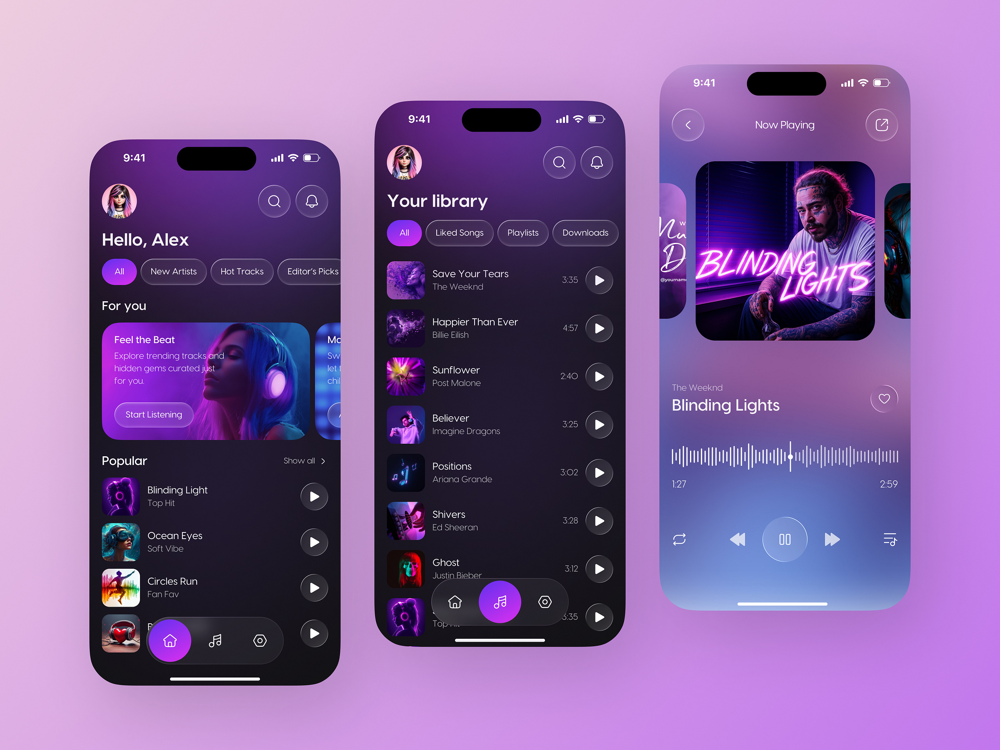
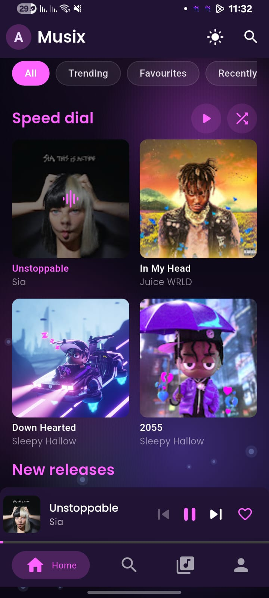
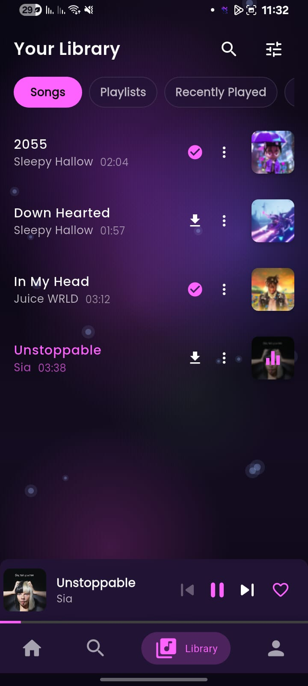
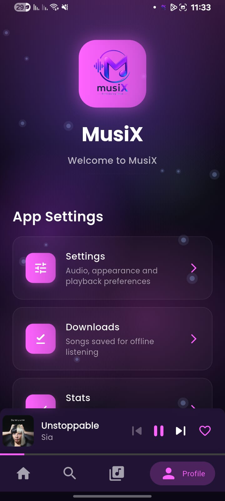

<div align="center">
  

  <h1>MusiX</h1>

  <p>
    A free and open source YouTube Music client for Android — streaming, downloads, lyrics, and a local library you fully control.
  </p>

  <!-- Badges -->
  <p>
    <a href="https://github.com/khisa318/music_app/releases/latest">
      
    </a>
    <a href="https://github.com/khisa318/music_app/releases">
      
    </a>
    <a href="https://github.com/khisa318/music_app/actions/workflows/ci.yml">
      
    </a>
    
  </p>

  <p>
    <a href="https://github.com/khisa318/music_app/releases">Download</a> ·
    <a href="https://github.com/khisa318/music_app/issues">Issues</a>
  </p>

  <p>
    <strong>Contact &amp; Support:</strong> open an issue on
    <a href="https://github.com/khisa318/music_app/issues">GitHub Issues</a>
  </p>
</div>

## 🎵 About MusiX

MusiX is a free and open source YouTube Music client for **Android**, built with Flutter. It focuses on smooth playback, offline listening, rich customization, and privacy-first local data control.

### At a Glance

- Stream from YouTube Music, with optional JioSaavn support.
- Download tracks and full playlists for offline listening, with ID3 tag handling.
- Synced lyrics from YouTube Music, LRCLib, or AI providers.
- Import Spotify and YouTube playlists into a local, playable playlist.
- Built-in equalizer, sleep timer, and playback statistics.

## 📸 Screenshots

<p align="center">
  
</p>

| | | |
|---|---|---|
|  |  |  |

## ✨ Features

MusiX includes a wide set of features implemented in this repository:

### Streaming & Discovery

- Stream songs, albums, artists, playlists, and videos from YouTube Music.
- Optional JioSaavn integration for an alternate source.
- Country-aware Trending feed.
- Home sections for recently played, liked songs, favourite artists, and recent playlists.

### Search & Navigation

- Fast search with suggestions and search history.
- Grouped results by songs, albums, artists, and playlists.
- In-list search delegates for library and playlist/album screens.

### Playback Experience

- Background playback with a foreground media notification and media-button controls.
- Queue management: add to queue, play next, reorder, and clear.
- Playback controls: shuffle, repeat, speed, and seek-forward/seek-back actions.
- Resumed sessions: MusiX remembers what you were playing and where you left off.
- Redesigned player with a liquid-glass dock and a floating mini player.

### Downloads & Offline

- Download individual songs or complete playlists in one tap.
- Concurrent download queue with progress and preparing states.
- Configurable download quality.
- Embedded metadata/artwork handling with full ID3 tag support.
- Dedicated downloads screen for offline playback.

### Local Library

- Scan local audio files and play from device storage.
- Manage included/excluded folders and file extensions.
- Import local tracks into the active playback queue.

### Lyrics

- Multiple lyric providers: YouTube Music, LRCLib, and AI.
- AI lyric generation via Gemini/OpenAI (API key configurable).
- Synchronized and plain lyrics, with seek-to-line support.
- Caching for faster lyric access.

### Playlists, Favourites & Library Data

- Create, delete, and manage custom playlists.
- Import Spotify or YouTube playlists — pasted links are detected automatically, matched track-by-track, and saved as a local playable playlist.
- Add/remove songs from playlists via option sheets.
- Liked songs and favourite artists management.

### Audio Controls

- Built-in equalizer with presets and custom tuning.
- Streaming and downloading quality settings.

### Smart Utilities

- Sleep timer.
- Playback statistics (daily/weekly/monthly views, top artists).
- Connectivity status handling and graceful fallback.

### OTA Updates & Channels

- In-app update checking with `stable` and `beta` channels.
- Version-based update detection.
- Download progress, SHA-256 verification, and an install flow through Android's `PackageInstaller`.

### Customization & Accessibility

- Light, dark, and system theme modes.
- Adaptive/dynamic accent color and a manual accent color picker.
- "Reduce Effects" option to tone down blur and transparency.
- Multi-language support (20+ languages, including English, Hindi, Spanish, French, German, Russian, Ukrainian, Bengali, Japanese, Chinese, Urdu, Telugu, Tamil, and Marathi).

### Data & Settings Tools

- Export/import settings and app data selections.
- Granular clear actions (cache, playback stats, queues, logs, playlists, favourites, etc.).

### Sharing & Integrations

- Share song links and app links.
- Android share-intent support for incoming local files.

## 💻 Tech Stack

MusiX is built with Flutter and community packages. Core stack overview:

| Area | Libraries / Tools | Purpose |
|---|---|---|
| Framework | Flutter, Dart | Cross-platform app UI and business logic |
| State & DI | provider, get_it, go_router | State management, dependency injection, navigation |
| Audio Engine | media_kit, audio_service, audio_session, audio_video_progress_bar, sleek_circular_slider | Playback, background controls, media session integration |
| Streaming & Video | dart_ytmusic_api, youtube_explode_dart (git fork), youtube_player_flutter, flutter_inappwebview, jiosaavn | Streaming metadata, stream extraction, embedded player, alternate source |
| Downloads & Network | dio, http, connectivity_plus, flutter_local_notifications, flutter_cache_manager | Download pipeline, networking, and user notifications |
| Local Media & Metadata | metadata_god, audio_metadata_reader | Local song discovery, tags/artwork extraction |
| Storage | hive_ce, shared_preferences, path_provider | App data persistence and local storage paths |
| UI & Visualization | easy_localization, google_fonts, dynamic_color, palette_generator, flutter_animate, fl_chart, cached_network_image, shimmer, flutter_svg, persistent_bottom_nav_bar_v2 | Localization, visuals, animation, charts, and UI components |
| Platform Integrations | receive_sharing_intent, android_package_installer, package_info_plus, device_info_plus, permission_handler, file_picker, terminate_restart, speech_to_text, url_launcher | Intents, platform controls, permissions, file picking, restart/update helpers |
| Utilities | share_plus, collection, crypto, synchronized, talker_flutter, mime | Sharing, helpers, logging, progress UI |

(See `pubspec.yaml` for a full list and exact versions.)

## 🚀 Installation

### Android

1. Download the latest APK from the [Releases](https://github.com/khisa318/music_app/releases/latest) page.
2. Enable "Install from unknown sources" in your device settings.
3. Install the downloaded APK file.

> **Note:** Android only permits an update to install over an existing app if it is signed with the **same key**. See [Release signing](#release-signing).

## 🛠️ Development

Interested in contributing to MusiX? Here's how to get started.

### Prerequisites

- [Flutter SDK](https://flutter.dev/docs/get-started/install) (pinned to `3.47.5`, see `.flutter-version`)
- JDK 17
- Android SDK (compileSdk 37.0.0, minSdk 24)
- [Android Studio](https://developer.android.com/studio) or [Visual Studio Code](https://code.visualstudio.com/)

### Rust is required

The app depends on [`metadata_god`][metadata_god], which reads and writes ID3 tags via a Rust native library compiled from source at build time by [cargokit][cargokit]. A Rust toolchain must be installed or the APK builds *without* `libmetadata_god.so` and every metadata feature fails silently at runtime.

Install via [rustup](https://www.rust-lang.org/tools/install), then add the Android targets:

```bash
rustup target add aarch64-linux-android armv7-linux-androideabi x86_64-linux-android
```

#### Windows host caveat

Rust needs a linker for the *host* toolchain to compile build scripts. On Windows, the default MSVC toolchain requires Visual Studio's `link.exe`. To avoid that large install, use Rust's bundled MinGW toolchain instead:

```bash
rustup toolchain install stable-x86_64-pc-windows-gnu --profile minimal
rustup target add --toolchain stable-x86_64-pc-windows-gnu \
  aarch64-linux-android armv7-linux-android x86_64-linux-android
rustup set default-host x86_64-pc-windows-gnu
```

The `set default-host` step matters: cargokit invokes `rustup run stable`, and a bare `stable` resolves by **host triple**, not by `rustup default`.

### Setup

1. **Clone the repository:**
   ```bash
   git clone https://github.com/khisa318/music_app.git
   ```
2. **Navigate to the project directory:**
   ```bash
   cd music_app
   ```
3. **Install dependencies:**
   ```bash
   flutter pub get
   ```
4. **Run the app:**
   ```bash
   flutter run
   ```

### Build

```bash
flutter pub get
flutter build apk --debug      # build/app/outputs/flutter-apk/app-debug.apk
```

Release builds split per ABI and are much smaller than the universal APK:

```bash
flutter build apk --release --split-per-abi
```

Verify the Rust library actually landed in the APK:

```bash
unzip -l build/app/outputs/flutter-apk/app-debug.apk | grep metadata_god
```

Expect one `libmetadata_god.so` per ABI (`arm64-v8a`, `armeabi-v7a`, `x86_64`).

### Project Structure

```
music_app/
├── android/                     # Android build and platform code
├── assets/
│   ├── images/                  # Intro/onboarding artwork
│   ├── screenshots/             # README screenshots and mockup
│   └── translations/            # Localization JSON files
├── docs/                        # Changelogs and release metadata
├── lib/
│   ├── core/                    # Shared providers, services, models, constants, theme
│   ├── features/                # Feature-first modules (player, search, library, etc.)
│   ├── shared/                  # Cross-feature components
│   ├── widgets/                 # Shared widgets
│   └── main.dart                # App entry point
├── test/                        # Widget/unit tests
└── pubspec.yaml                 # Dependencies and project metadata
```

### Architecture

```
lib/
  core/
    providers/    app state (player, downloads, settings, queue, favourites, stats)
    services/     playback, audio URL resolution, downloads, notifications, OTA
    theme/        Material 3 theming
  features/       one directory per user-facing screen
  shared/         cross-feature components
  widgets/        shared widgets
```

State management is `provider`; navigation is `go_router`; local persistence is `hive_ce` with `shared_preferences` for settings.

**Background isolates** — audio URL resolution runs off the UI thread to keep playback responsive. Two providers are selected per track:

- `audio_url_isolate.dart` — YouTube (via `youtube_explode_dart`)
- `jiosaavn_isolate.dart` — JioSaavn (via `jiosaavn`)

**Playback** — `media_kit` (libmpv) handles decoding and `audio_service` runs the foreground notification and media-button controls.

## 🧪 Testing

```bash
flutter analyze
flutter test
```

`flutter analyze` should report no issues.

## 🔁 Releasing

`pubspec.yaml` is the single source of truth for the version:

```yaml
version: 1.0.4+5   # versionName 1.0.4, versionCode 5
```

Both halves must increase. Merging a `version:` bump to `main` triggers `.github/workflows/tag-release.yml`, which creates the matching `v*` tag; `.github/workflows/release.yml` then builds, signs, verifies, and publishes the GitHub Release. CI pins Flutter to `.flutter-version` (`3.47.5`) rather than `latest`.

### Release signing

The keystore lives outside the repository. For local builds, copy `android/key.properties.template` to `android/key.properties` and fill in the values (it is gitignored). For CI, four repository secrets carry the same values: `MUSIX_KEYSTORE_BASE64`, `MUSIX_KEYSTORE_PASSWORD`, `MUSIX_KEY_ALIAS`, `MUSIX_KEY_PASSWORD`.

## 🙌 Credits

This project stands on the work of many open-source maintainers and contributors. The full dependency list is in `pubspec.yaml`; the core packages that make MusiX possible include:

- **Audio & playback** – media_kit, audio_service, audio_session, audio_video_progress_bar, sleek_circular_slider
- **Streaming & metadata** – dart_ytmusic_api, youtube_explode_dart (custom fork), youtube_player_flutter, flutter_inappwebview, jiosaavn
- **Networking & downloads** – dio, http, connectivity_plus, flutter_local_notifications, flutter_cache_manager
- **Local media** – metadata_god, audio_metadata_reader
- **Storage & persistence** – hive_ce, shared_preferences, path_provider
- **Routing & state** – go_router, provider, get_it
- **UI & visuals** – easy_localization, google_fonts, dynamic_color, palette_generator, flutter_animate, fl_chart, cached_network_image, shimmer, flutter_svg, persistent_bottom_nav_bar_v2
- **Platform utilities** – receive_sharing_intent, android_package_installer, package_info_plus, device_info_plus, permission_handler, file_picker, terminate_restart, url_launcher
- **General utilities** – collection, crypto, synchronized, talker_flutter, mime, share_plus

Thank you to everyone building and maintaining these open-source libraries and tools.

## 🤝 Contributing

- Work on a branch: `feat/...`, `fix/...`, `chore/...`, `docs/...`.
- Open a pull request. `.github/workflows/ci.yml` runs format checks, `flutter analyze`, `flutter test`, and a debug build on every PR and on every push to `main`.
- See [CONTRIBUTING.md](CONTRIBUTING.md) for the day-to-day workflow.

## ⚠️ Disclaimer

MusiX is an unofficial client and is not affiliated with YouTube, Google, JioSaavn, or Spotify in any way. It is intended for educational and personal use only.

[metadata_god]: https://pub.dev/packages/metadata_god
[cargokit]: https://pub.dev/packages/cargokit
